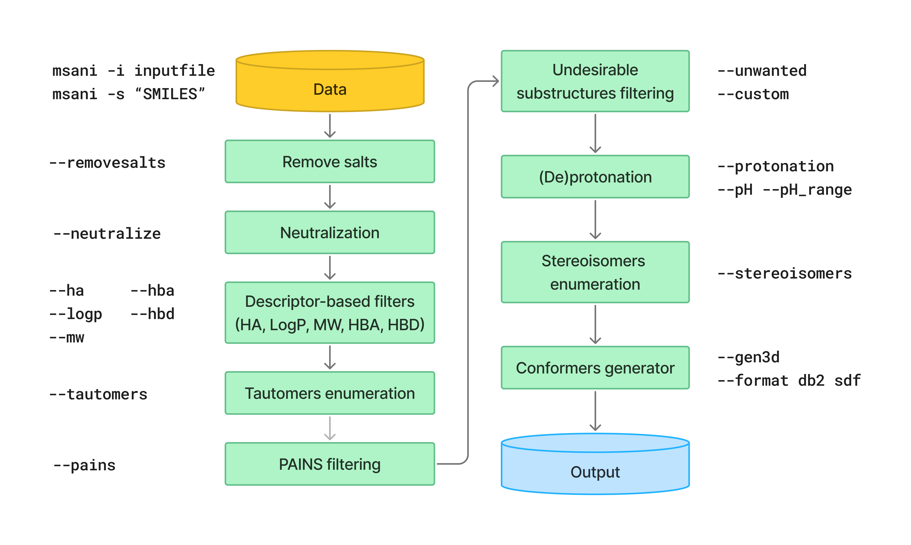

<p align="center">
  
</p>

<p align="center">
  <a href="https://pypi.org/project/MolSanitizer/"></a>
  <a href="https://github.com/carlssonlab/MolSanitizer/blob/main/pyproject.toml"></a>
  <a href="https://msani.readthedocs.io/en/stable/"></a>
  <a href="https://github.com/carlssonlab/MolSanitizer/blob/main/LICENSE"></a>
</p>

<p align="center">
  <a href="https://chemrxiv.org/doi/full/10.26434/chemrxiv.15010189/v1"></a>
  <a href="https://github.com/carlssonlab/MolSanitizer/stargazers"></a>
  <a href="https://pypistats.org/packages/molsanitizer"></a>
</p>

MolSanitizer (`msani`) prepares SMILES libraries for structure-based drug
discovery. It standardizes molecules (salt removal, tautomer and protonation
state enumeration, stereoisomer enumeration), filters undesirable substructures
(PAINS, reactive functional groups, and more), and generates 3D conformers in
formats ready for docking.




## Trying quickly

A web app is available to try at [carlssonlabtools.icm.uu.se/molsani](https://carlssonlabtools.icm.uu.se/molsani).

## Installation

```bash
pip install molsanitizer
```

Prebuilt wheels are available for MacOS, Linux and Windows. For building from source
and details on dependencies, see the
[installation guide](https://msani.readthedocs.io/en/stable/installation.html).

### Optional dependencies

| Feature | Install | Notes |
| --- | --- | --- |
| PDBQT output | `pip install "molsanitizer[pdbqt]"` | Requires Meeko. |
| OEB output | `pip install "molsanitizer[oe]"` | Requires OpenEye toolkits and a licence (`export OE_LICENSE=/path/to/oe_license.txt`). |
| Open Babel embedding | `conda install openbabel` | Used when selected as the embedding method, or as a fallback after an RDKit embedding timeout. |

## Quick start

Create `example.smi` (one SMILES and ID per line, no header):

```text
Nc1nc(C(=CCC(=O)O)C(=O)NC2C(=O)N3C(C(=O)O)=CCSC23)cs1 Ceftibuten
CC(C)Cc1ccc(cc1)[C@@H](C)C(=O)O Ibuprofen
C[C@]1(c2cccc(c2C(=O)C3=C([C@]4([C@@H](C[C@@H]31)[C@@H](C(=C(C4=O)C(=O)N)O)N(C)C)O)O)O)O Tetracycline
O=C1NC(=O)NC(=O)C1(c2ccccc2)CC Phenobarbital
```

CXSMILES is recognized automatically. Use tab-separated structures and IDs,
or wrap the complete CXSMILES field in double quotes for space-separated input:

```text
"C[C@H](O)F |&1:1|" compound_001
CCO ethanol
```

Keep column separators consistent throughout the file. The optional `-e` flag
forces tab-separated parsing; omit it for the space-separated example above.

Prepare the SMILES (strip salts, enumerate tautomers, protonate at pH 7):

```bash
msani -i example.smi --removesalts --tautomers --protonation --pH 7
```

This writes `example_clean.smi`, where acetic acid is deprotonated:

```text
Nc1nc(C(=CCC(=O)[O-])C(=O)NC2C(=O)N3C(C(=O)[O-])=CCSC23)cs1 Ceftibuten
CC(C)Cc1ccc([C@@H](C)C(=O)[O-])cc1 Ibuprofen
C[NH+](C)[C@@H]1C([O-])=C(C(N)=O)C(=O)[C@@]2(O)C(O)=C3C(=O)c4c(O)cccc4[C@@](C)(O)[C@H]3C[C@@H]12 Tetracycline_1
C[NH+](C)[C@@H]1C([O-])=C(C(N)=O)C(=O)[C@@]2(O)C([O-])=C3C(=O)c4c(O)cccc4[C@@](C)(O)[C@H]3C[C@@H]12 Tetracycline_2
CCC1(c2ccccc2)C(=O)NC(=O)NC1=O Phenobarbital_1
CCC1(c2ccccc2)C(=O)[N-]C(=O)NC1=O Phenobarbital_2
```

Generate 3D structures for docking from the prepared file:

```bash
msani -i example_clean.smi --gen3d --format sdf --numconfs 20   # SDF conformer ensembles
msani -i example_clean.smi --gen3d --format db2                 # DOCK3/DOCK6
msani -i example_clean.smi --gen3d --format mol2                # Mol2 format
msani -i example_clean.smi --gen3d --format pdbqt               # AutoDock Vina (needs [pdbqt])
msani -i example_clean.smi --gen3d --format oeb.lib             # OpenEye FRED/HYBRID (needs [oe])
```

Each format is written to its own directory (`sdf/`, `db2/`, `pdbqt/`, `oeb/`, `mol2/`).
Several formats can be requested at once, e.g. `--format sdf db2`. Run
`msani -h` for all options, and see the
[quickstart](https://msani.readthedocs.io/en/stable/quickstart.html) and
[output documentation](https://msani.readthedocs.io/en/stable/outputs.html)
for details.

## Use with AI agents

The [MolSanitizer agent skill](skills/molsanitizer/SKILL.md) guides agents through
CLI and Python workflows, including preparation settings, output formats,
failure checks, and SLURM batch processing. Install MolSanitizer in the agent's
execution environment, then copy the `skills/molsanitizer/` folder into your
agent's supported skill directory, or ask it to read the file from this checkout:

```text
Read skills/molsanitizer/SKILL.md and use it to prepare example.smi.
Remove salts, prepare tautomers, and protonate at pH 7 with pH_range 1.
Generate up to 20 SDF conformers per prepared molecule using two cores
in a new output directory. Report the settings, outputs, and failures.
```

The [agent quickstart](https://msani.readthedocs.io/en/latest/quickstart.html#use-molsanitizer-with-an-ai-agent)
also provides a downloadable skill. Use the skill from the same checkout or
documentation version as your MolSanitizer installation.

## Configuration

MolSanitizer runs with bundled defaults out of the box. To set personal
defaults (for example, tool paths or cluster settings), create a config file:

```bash
msani config init
```

The command prints the location of `msani_configurations.yaml`
(`~/.config/msani/` on Linux, `~/Library/Application Support/msani/` on macOS,
`%LOCALAPPDATA%\msani\` on Windows). Add only the settings you want to override:

```yaml
CORINA: /opt/corina/corina
SLURM_ACCOUNT: my-project
NUMCONFS: 1000
MAX_JOBS: 100
```

Useful commands:

```bash
msani config show                            # merged settings and where each comes from
msani config use /shared/mygroup/msani.yaml  # select an existing config file
msani config reset-path                      # return to the standard location
```

Command-line arguments always take priority over the config file. For a
one-off override, set `MSANI_CONFIG=/path/to/config.yaml`. See the
[configuration guide](https://msani.readthedocs.io/en/stable/config.html) for
precedence rules and batch jobs.

## Documentation

Full documentation for the released version, including the methodology behind
MolSanitizer, is available in the
[stable documentation](https://msani.readthedocs.io/en/stable/).
For source installs from `main`, use the
[development documentation](https://msani.readthedocs.io/en/latest/), which may
describe features that have not been released yet.


## Contributing

Contributions are welcome — bug reports, feature suggestions, and pull
requests alike. Please read [CONTRIBUTING.md](https://github.com/carlssonlab/MolSanitizer/blob/main/CONTRIBUTING.md) before getting
started. Python workflows live in `msani/`; native code and bindings are in
[`msani/cpp/`](https://github.com/carlssonlab/MolSanitizer/blob/main/msani/cpp/README.md).

MolSanitizer is rule-based and draws on experience from prior drug discovery
projects. Suggestions for new filter, tautomer, or protonation rules are
especially appreciated — please open an issue.

## Citation

If you use MolSanitizer in your research, please cite:

> Lam, T.-P.; Pach, S.; Ullmann, P.; et al. MolSanitizer: An open-source
> pipeline to prepare small-molecule databases for large-scale virtual
> screening. *ChemRxiv* **2026**. DOI: [10.26434/chemrxiv.15010189/v1](https://chemrxiv.org/doi/full/10.26434/chemrxiv.15010189/v1)

## License

Distributed under the Apache License 2.0. See [LICENSE](https://github.com/carlssonlab/MolSanitizer/blob/main/LICENSE).

## Contact

- Thua-Phong Lam — phong.lam@icm.uu.se
- Szymon Pach — szymon.pach@pharmazie.uni-marburg.de
- Israel Cabeza de Vaca Lopez — israel.cabezadevaca@icm.uu.se

## Acknowledgements

This work was funded by the Knut and Alice Wallenberg Foundation (KAW 2019.0130), the Swedish strategic research program eSSENCE, the Swedish Cancer Society (25 4860 Pj), the Swedish Brain Foundation (FO2026-0435), and the Swedish Research Council (2025-06266 and 2025-06720). The computational work was enabled by resources provided by the National Academic Infrastructure for Supercomputing in Sweden (NAISS) and the Swedish National Infrastructure for Computing (SNIC) at NSC, partially funded by the Swedish Research Council through grant agreement nos. 2022-06725 and 2018-05973. The Chemical Biology Consortium Sweden (CBCS), node KI, is a national research infrastructure funded by the Swedish Research Council (dr.nr. 2021-00179) and SciLifeLab.
